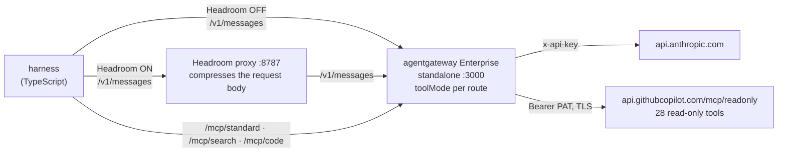

# Tool modes and Headroom: do the savings stack?

Two tools claim to cut token cost for agents that use MCP. They work on different layers:

| | Reduces | How |
|---|---|---|
| **agentgateway tool modes** (Solo Enterprise) | the tool catalog and the round trips | `search`: 28 tool schemas become 2 meta-tools. `code`: many calls become one `run_code`. |
| **[Headroom](https://github.com/headroomlabs-ai/headroom)** | the content: tool results and conversation history | A local proxy that compresses the request body (JSON, code, text) before it reaches the model |

They are not substitutes. Tool modes act on the catalog, and Headroom acts on the data. This example runs the same GitHub questions through **every combination** and asks whether the two savings add up, and what it costs in answer quality.

It follows [demo 105](https://github.com/sebbycorp/agentgateway-demos/tree/main/105-ent-headroom-comp-tokenomics) and the [maniak.io write-up](https://maniak.io/articles/2026-06-22-headroom-agentgateway-mcp-token-stacking/), with three differences: it runs **standalone** (no Kubernetes), the model is **Claude** through agentgateway's Anthropic route, and the Headroom flags follow Headroom 0.40.

> **Measured (single run, `claude-opus-5-5`, agentgateway Enterprise v2026.10.0, Headroom 0.40.0).** Here the savings mostly **did not stack**. Headroom changed the cost of `standard` mode by 0%. In `code` mode it saved 4% to 18% with no real quality loss. In `search` mode on the large repo it cut tokens by 30% to 42% on the big lists, but the answers lost half of the items. Lossless mode kept the answers complete and compressed almost nothing. Details and caveats are in [Results](#results). They do not reproduce the blog's large savings.

## Architecture



The two knobs touch different arrows, which is why stacking is possible:

- **Knob 1, `toolMode`:** three routes (`/mcp/standard`, `/mcp/search`, `/mcp/code`) in front of the same upstream. They change what the harness puts in the `tools` field.
- **Knob 2, Headroom:** OFF sends the model call to the gateway. ON sends it to Headroom, which compresses it and forwards it to the gateway's `/v1/messages`. The gateway still adds the API key and logs the call. The MCP calls go to the gateway either way.

## The experiment

**3 modes × 2 Headroom states × 2 repositories = 12 cells.** Each cell asks five questions. The harness records prompt tokens (split into uncached, cache read and cache write), output tokens, model calls, cost, and an LLM-judge quality score.

| Questions | Why |
|---|---|
| `repo`: description, default branch, language, open issues | small result |
| `commits`: the 5 latest commits, with 7-character SHAs | tests identifiers, which compression can damage |
| `issues`: open issues, first page of 30 | large JSON list |
| `prs`: open pull requests, first page of 30 | large JSON list |
| `contents`: files and folders in the root | medium list |

| Repository | Why |
|---|---|
| small: `hguerrero/agentgateway-examples` (this repo) | little data, so little to compress |
| large: `agentgateway/agentgateway` | hundreds of open issues and PRs, so big payloads |

**Quality judge.** Headroom changes what the model sees, so a cheaper cell is only a win if the answer is still right. `matrix.ts` scores every answer from 0 to 5 against the `standard` / Headroom-OFF answer for the same question. The judge call goes straight to the gateway, so the grader never reads compressed text.

**Prompt caching is on in every cell**, as in a production agent: one cache breakpoint on the system block (which covers the tool catalog before it) and one on the growing conversation. The big, stable catalog caches well, and a proxy that rewrites the prompt can lose that. Each cell starts with a cold cache of its own (a session id in the system prompt), so a cell never gets a free cache entry written by another cell. Without that, the cell that runs first pays for the cache write and the next one reads it for free, and the cost difference would not be about Headroom.

## Prerequisites

| Need | Why |
|---|---|
| Solo Enterprise agentgateway license | `toolMode` is an Enterprise feature. The proxy does not start without a valid key. |
| Anthropic API key | The model calls. A full matrix costs about $2.50 with `claude-opus-5-5`. |
| GitHub token | Read-only. GitHub's MCP server needs one, even for public repositories. |
| Node.js 18+ | The harness |
| Python 3.10+ | Headroom. The script installs it into `./.venv` (about 700 MB). |
| macOS (Apple Silicon) or Linux | The Enterprise standalone binary |

For the GitHub token, create a [fine-grained token](https://github.com/settings/personal-access-tokens) with read-only access (Contents, Issues, Pull requests, Metadata) to the repositories you want to query. See [Scope and safety](#scope-and-safety).

## Quick start

Use three terminals.

### 1. Install the Enterprise proxy

```bash
curl -fsSL https://run.solo.io/agentgateway/install | sh
~/.agentgateway/bin/agentgateway --version      # expect a version like v2026.10.0
```

### 2. Terminal 1: start the gateway

```bash
export AGENTGATEWAY_LICENSE_KEY=...        # or ENTERPRISE_AGENTGATEWAY_LICENSE_KEY
export ANTHROPIC_API_KEY=...
export GITHUB_PAT=...                      # read-only
./scripts/run-gateway.sh
```

The script refuses to start the open-source proxy, because it would silently run every route in standard mode. Wait a few seconds after it starts, so the gateway can resolve the upstream hostnames.

### 3. Terminal 2: start Headroom

```bash
./scripts/run-headroom.sh
```

The first run creates `./.venv`, installs `headroom-ai[proxy]`, and starts the proxy on port 8787. The first start also downloads the Kompress model from Hugging Face, so give it a minute. The script sets `HEADROOM_BEACON=off`.

### 4. Terminal 3: smoke test, then the matrix

```bash
cd harness
npm install
npm run smoke      # one question, search mode, Headroom OFF then ON
npm run matrix     # all 12 cells, then the quality judge (about 10 minutes)
```

The harness checks that each route exposes the tools its mode should, and that Headroom answers. Results are saved to `harness/results/`.

## Headroom flags

`run-headroom.sh` starts Headroom with:

```bash
ANTHROPIC_TARGET_API_URL=http://localhost:3000 \
headroom proxy --port 8787 --mode token --stateless --no-cache --no-ccr
```

| Setting | Why |
|---|---|
| `ANTHROPIC_TARGET_API_URL` | Headroom's upstream is the gateway, so the gateway still supplies the key and logs every call |
| `--mode token` | prioritise compression. Prior turns may be rewritten for maximum savings. (`--mode cache` freezes prior turns to keep the provider's prompt cache.) |
| `--stateless` | no filesystem writes |
| `--no-cache` | no semantic cache. The harness sends many near-identical tool-calling requests, and a semantic cache could answer one with a stale response. |
| `--no-ccr` | no retrieval markers and no injected retrieval tool. The model works through MCP tools, and an extra injected tool breaks that flow. Compression is lossy. |
| `HEADROOM_LOSSLESS=1` | uses `--lossless` instead of `--no-ccr`: compaction that loses nothing, with no markers either |

The demo this follows used `--no-ccr-inject-tool --no-ccr-marker`. In Headroom 0.40.0, `--no-ccr` does the same job: `headroom proxy --help` describes it as no retrieval markers and no injected retrieval tool. I did not find the old flag names in the help.

Headroom compresses by default. If you start it with `--no-optimize`, it is a plain passthrough, and the ON column would equal the OFF column.

## Results

One full run, both repositories, five questions per cell, `claude-opus-5-5` at low effort. Prices: $4 per million input tokens, $0.20 cache read, $5 cache write, $20 output. Headroom started as in [Headroom flags](#headroom-flags) (lossy, `--no-ccr`).

**Small repository** (little data to compress)

| Mode | OFF cost | ON cost | Change | OFF prompt tokens | ON prompt tokens | OFF quality | ON quality |
|---|---|---|---|---|---|---|---|
| `standard` | $0.1289 | $0.1293 | +0% | 123,002 | 122,525 | 5.0 | 5.0 |
| `search` | $0.0541 | $0.0700 | +29% | 15,576 | 19,750 | 5.0 | 4.8 |
| `code` | $0.1195 | $0.0985 | -18% | 114,408 | 98,791 | 5.0 | 4.8 |

**Large repository** (big JSON lists)

| Mode | OFF cost | ON cost | Change | OFF prompt tokens | ON prompt tokens | OFF quality | ON quality |
|---|---|---|---|---|---|---|---|
| `standard` | $0.2186 | $0.2187 | +0% | 129,866 | 129,010 | 5.0 | 5.0 |
| `search` | $0.4563 | $0.3323 | -27% | 83,115 | 61,808 | 5.0 | **3.8** |
| `code` | $0.1854 | $0.1779 | -4% | 116,697 | 103,943 | 5.0 | 4.8 |

**Both repositories together**

| Mode | OFF cost | ON cost | Change | OFF quality | ON quality |
|---|---|---|---|---|---|
| `standard` | $0.3476 | $0.3481 | +0% | 5.0 | 5.0 |
| `search` | $0.5103 | $0.4023 | -21% | 5.0 | 4.3 |
| `code` | $0.3049 | $0.2763 | -9% | 5.0 | 4.8 |

Headroom's own log for this run: 63 requests, 403,203 prompt tokens before and 381,149 after, so **5% saved overall**.

### What the numbers show

**1. `standard`: no change.** The 28 tool schemas are the same on every call, and Headroom did not shrink them in this run. In this run the questions in `standard` mode brought back small tool results. A question took about 26,000 prompt tokens, of which about 24,000 were the catalog. There was little data to compress.

**2. `code`: a small, steady saving, with the quality intact.** Prompt tokens fell 12% (231,105 to 202,734), and cost fell 18% on the small repository and 4% on the large one. The other complete runs I did (with earlier versions of the questions) showed the same 12% to 13% drop in prompt tokens. Code mode keeps tool results out of the context, so the saving is not about data. The `run_code` tool description carries the typed API for all 28 tools, and I believe that is what Headroom compresses. I did not check which part of the request it shortens. Quality averaged 4.8 on both repositories, so one answer in each scored 4 and the rest scored 5.

**3. `search` on the large repo: big token savings, and the answers lost data.** With a page of 30 issues or PRs in the context, Headroom cut prompt tokens by 30% (issues: 30,970 to 21,639) and 42% (PRs: 25,312 to 14,801). The answers were not complete:

| Question | Headroom OFF | Headroom ON |
|---|---|---|
| `issues` (30 returned by GitHub) | all 30 listed, quality 5 | **18 of 30 listed**, quality 2 |
| `prs` (30 returned by GitHub) | all 30 listed, quality 5 | **15 of 30 listed**, quality 2, and the model said there were no more pages |

The items the model did list were accurate. With `--no-ccr` there is no way to get the dropped items back. The model sees a shorter list and answers from it. This is the same quality warning as in the blog, and the cost saving (-27% here) came with a quality score of 3.8.

**4. Lossless mode keeps the answers, and compresses very little.** I ran the large repository again with `HEADROOM_LOSSLESS=1`. No answer scored below 4 (the cell averages were 4.8 or higher), and the `search` list questions were unchanged (the PR question sent 25,312 tokens with Headroom off and 25,314 with it on). Headroom's log for that run shows 4% saved overall. In `code` mode the cost change was -5%.

| Large repository, lossless | OFF cost | ON cost | OFF quality | ON quality |
|---|---|---|---|---|
| `standard` | $0.2177 | $0.2176 | 5.0 | 5.0 |
| `search` | $0.3098 | $0.4538 | 4.8 | 4.8 |
| `code` | $0.1876 | $0.1779 | 5.0 | 4.8 |

The `search` row is noise, not an effect of Headroom. In that run the model fetched a small page of issues with Headroom off and the full page with Headroom on, and the full page costs more. See the caveats below.

### So, do they stack?

In this setup, only a little, and not for free:

- Tool modes did the larger part of the saving. In the [`mcp-toolmodes`](../mcp-toolmodes/) example, search cut cost by 46% and code by 37% without any compression.
- On top of a tool mode, Headroom added **0% to 18%** in `standard` and `code`, and **up to 27% in `search` at a cost in quality** (lossy mode) or almost nothing (lossless mode).
- The one place where compression engaged strongly, big lists in the context, is also the place where it dropped items.
- If your tasks depend on exact identifiers or complete lists (commit SHAs, issue numbers, every row), do not use lossy compression. The judge in the blog caught SHAs being damaged. Here it caught lists being cut.

I did not reproduce the blog's savings (about 36% for `search` and 63% for `code` on a large repository). I do not know why. The setup differs in the model and provider (Claude instead of `gpt-5.5`), in how prompt caching works (explicit breakpoints instead of automatic prefix caching), in the Headroom version, and in the repositories. Treat the numbers here as a measurement of this setup, and run the matrix on your own workload.

### Caveats

- **Single runs are noisy.** The model picks its own steps and its own page sizes, and the page size changes the cost more than Headroom does. Before I fixed the page size in the `issues` and `prs` questions, the same large-repository `search` cell measured -2% in one run and -44% in another, and the difference was mostly how much data the model asked for. Run the matrix at least three times before you quote a range.
- **The OFF and ON runs are not paired.** Each cell is a separate conversation, so small differences (a few percent) are not meaningful. The `search` row on the small repository (+29%) is an example.
- **The judge is a model.** Scores are relative to the `standard` / OFF answer, not to the truth. The harness prints every answer below 4 so you can read them.
- **Prompt caching is on.** Costs here are lower than in the [`mcp-toolmodes`](../mcp-toolmodes/) example, which ran with caching off.
- **Pricing is for `claude-opus-5-5`.** Set `PRICE_INPUT` and `PRICE_OUTPUT` (USD per million tokens) if you use another model.

## Options

| Variable | Default | What it does |
|---|---|---|
| `MODES` | `standard,search,code` | Which routes to run |
| `HEADROOM` | `off,on` | Which Headroom states to run |
| `REPOS` | `small,large` | Which repositories to run |
| `QUESTIONS` | all five | For example `QUESTIONS=commits,issues` |
| `REPO_SMALL`, `REPO_LARGE` | this repo, `agentgateway/agentgateway` | The repositories. Your token must be able to read them. |
| `MODEL` | `claude-opus-5-5` | The model |
| `JUDGE`, `JUDGE_MODEL` | on, same as `MODEL` | The quality judge |
| `PROMPT_CACHE` | `on` | Set `off` to turn prompt caching off |
| `GATEWAY_URL`, `HEADROOM_URL` | `http://localhost:3000`, `http://localhost:8787` | Where the gateway and Headroom listen |

For the Headroom script: `HEADROOM_PORT`, `HEADROOM_MODE` (`token` or `cache`), `HEADROOM_LOSSLESS=1`, `HEADROOM_EXTRAS` (pip extras; the reference demo installs `all`, which is much larger).

## Scope and safety

1. **Read-only by construction.** The upstream path is `/mcp/readonly`, GitHub's read-only surface: `get_*`, `list_*` and `search_*` tools, no write tools. Do not use `/mcp/all/readonly`, which also lists write tools.
2. **Scope the token.** Use a fine-grained token with read-only access to the repositories you ask about. This is the real guarantee.
3. **The repository is a prompt, not a guard.** The system prompt tells the model to use only the repository in the question, but the model could still query anything the token can read.
4. **Headroom runs on your machine.** It compresses locally, and prompts are not sent anywhere for compression. It downloads a model from Hugging Face on first start. The script turns off its usage beacon.
5. **Secrets stay out of git.** The gateway reads `GITHUB_PAT`, `ANTHROPIC_API_KEY` and the license from the environment. `harness/.env`, `results/`, `logs/` and `.venv/` are ignored.

## Troubleshooting

| Symptom | Check |
|---|---|
| The proxy does not start | The license is missing or not valid. Check `ENTERPRISE_AGENTGATEWAY_LICENSE_KEY`. |
| `run-gateway.sh` says the binary is not the Enterprise build | `agentgateway` on your `PATH` is the open-source `1.x` proxy. Use `~/.agentgateway/bin/agentgateway` or set `AGENTGATEWAY_BIN`. |
| `503 backends required DNS resolution which failed` or `No route to host` | If the gateway was started a moment ago, wait a few seconds. If it keeps happening, your network may have a broken IPv6 path. Set `config.dns.lookupFamily: V4Only` (the comment in `config.yaml` shows how). A matrix run is long enough to hit this, and the SDK's retries can hide it until the judge runs. |
| The harness says Headroom does not answer | Start `./scripts/run-headroom.sh` and wait for the model download, or run with `HEADROOM=off`. |
| Headroom ON equals Headroom OFF | Check that Headroom was not started with `--no-optimize`. The harness sends the ON calls to `HEADROOM_URL`. |
| Headroom ON fails with MCP or tool errors | Start it with `--no-cache` and `--no-ccr` (or `--lossless`), as the script does. The demo this follows reported that Headroom's semantic cache and its injected retrieval tool broke MCP tool calling. I did not test it without these flags. |
| The harness stops with "not what toolMode ... should expose" | The route is in the wrong mode. Check that you run the Enterprise proxy with this config. |
| `Address already in use` | Another gateway uses port 3000 or the admin ports (15000, 15020, 15021), or something uses port 8787. |

## Resources

- [Headroom](https://github.com/headroomlabs-ai/headroom)
- [Demo 105: tool modes and Headroom (Kubernetes)](https://github.com/sebbycorp/agentgateway-demos/tree/main/105-ent-headroom-comp-tokenomics) and the [write-up](https://maniak.io/articles/2026-06-22-headroom-agentgateway-mcp-token-stacking/)
- [Solo Enterprise agentgateway: tool modes (standalone)](https://docs.solo.io/agentgateway/standalone/latest/documentation/mcp/tool-mode/)
- [`mcp-toolmodes`](../mcp-toolmodes/) in this repo: the tool modes without Headroom
