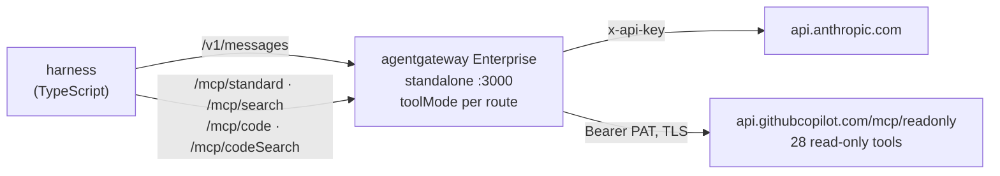

# MCP tool modes with Solo Enterprise agentgateway

An agent that uses an MCP server pays for the whole tool catalog on every model call. GitHub's MCP server has 28 tools, and their schemas add up to about 11,700 tokens (measured with `claude-opus-5-5`), sent again with every request, even when the question needs one tool.

**Tool modes** are a feature of Solo Enterprise agentgateway that implements progressive disclosure for MCP. The gateway does not hand the client the full catalog. It presents the tools as a **search** interface, a **code** interface, or both. This example serves the same upstream in all four modes and lets you compare them.

The open-source proxy ignores `toolMode` and always runs in `standard` mode. This example runs the Enterprise proxy standalone, with no Kubernetes.

## The four modes

These are the modes documented for [standalone Solo Enterprise agentgateway](https://docs.solo.io/agentgateway/standalone/latest/documentation/mcp/tool-mode/):

| `toolMode` | Tools the client sees | Use it when |
|---|---|---|
| `standard` | every upstream tool (the default) | the catalog is small enough to send in full |
| `search` | `get_tool`, `invoke_tool` | many tools, and an agent uses a few per task |
| `code` | `run_code` | an agent chains several calls, and a round trip each is wasteful |
| `codeSearch` | `get_tool`, `run_code` | many tools, and the task chains calls |

How each one works:

- **`standard`**: the client gets every authorized tool with its complete definition.
- **`search`**: the agent calls `get_tool` to look up one definition, then `invoke_tool` to run it. The full catalog never enters the model's context.
- **`code`**: the client gets a single `run_code` tool. The JavaScript API for the upstream tools is embedded in its description. The agent submits a script, the gateway runs it in a sandbox, and only the script's result comes back.
- **`codeSearch`**: search and code combined. The agent calls `get_tool` for the signature of the tools it needs, then `run_code` to run a script against them. The `run_code` description holds no API, so the context stays small.

All four routes are in [`agentgateway-config/config.yaml`](agentgateway-config/config.yaml), over the same upstream. Only `toolMode` differs.

### What each route exposes

I listed the tools on each route of this example's gateway (no model involved):

| Route | Tools | Size of the `tools/list` response | `run_code` description |
|---|---|---|---|
| `/mcp/standard` | 28 (`get_commit`, `get_file_contents`, ...) | 74,421 bytes | |
| `/mcp/search` | `get_tool`, `invoke_tool` | 2,153 bytes | |
| `/mcp/code` | `run_code` | 27,685 bytes | about 26,000 characters, with 28 function declarations |
| `/mcp/codeSearch` | `get_tool`, `run_code` | 3,534 bytes | about 1,250 characters, with no function declarations |

So `code` mode still sends most of the catalog (inside the `run_code` description), and `codeSearch` is as small as `search`. The harness checks that each route exposes these tools, and stops if it does not.

## Architecture



The model calls go through the gateway too (`/v1/messages`), so the gateway holds both secrets and logs both kinds of traffic.

## Components

```
mcp-toolmodes/
├── agentgateway-config/
│   └── config.yaml       # Anthropic route and the four MCP routes
├── harness/
│   └── src/run.ts        # runs the questions in each mode and prints the comparison
└── scripts/
    └── run-gateway.sh    # starts the Enterprise proxy with this config
```

## Prerequisites

| Need | Why |
|---|---|
| Solo Enterprise agentgateway license | `toolMode` is an Enterprise feature. The proxy does not start without a valid key. |
| Anthropic API key | The model calls (only the harness needs them) |
| GitHub token | Read-only. GitHub's MCP server needs one, even for public repositories. |
| Node.js 18+ | The harness |
| macOS (Apple Silicon) or Linux | The Enterprise standalone binary. On other platforms, use the container image. |

For the GitHub token, create a [fine-grained token](https://github.com/settings/personal-access-tokens) with read-only access (Contents, Issues, Pull requests, Metadata) to the repository you want to query. See [Scope and safety](#scope-and-safety).

## Quick start

### 1. Install the Enterprise proxy

```bash
curl -fsSL https://run.solo.io/agentgateway/install | sh
~/.agentgateway/bin/agentgateway --version      # expect a version like v2026.10.0
```

This installs `agentgateway` in `~/.agentgateway/bin`. Enterprise versions look like `v2026.x.y`. The open-source proxy is `1.x`.

### 2. Start the gateway

```bash
export AGENTGATEWAY_LICENSE_KEY=...        # or ENTERPRISE_AGENTGATEWAY_LICENSE_KEY
export ANTHROPIC_API_KEY=...
export GITHUB_PAT=...                      # read-only
./scripts/run-gateway.sh
```

The script refuses to start the open-source proxy, because it would silently run every route in standard mode. Wait a few seconds after it starts, so the gateway can resolve the upstream hostnames. The admin UI is at http://localhost:15000/ui.

### 3. Try it by hand (no model needed)

With the gateway running, list the tools in each mode:

```bash
for r in standard search code codeSearch; do
  echo -n "$r: "
  curl -s -X POST localhost:3000/mcp/$r \
    -H 'Content-Type: application/json' -H 'Accept: application/json, text/event-stream' \
    -d '{"jsonrpc":"2.0","id":1,"method":"tools/list","params":{}}' \
    | sed 's/^data: //' | grep '^{' | jq -c '[.result.tools[].name] | if length > 3 then .[:3] + ["... \(length) tools"] else . end'
done
```

Search mode: find a tool, then call it.

```bash
rpc() { curl -s -X POST localhost:3000/mcp/$1 -H 'Content-Type: application/json' \
  -H 'Accept: application/json, text/event-stream' -d "$2" | sed 's/^data: //' | grep '^{'; }

rpc search '{"jsonrpc":"2.0","id":1,"method":"tools/call","params":{"name":"get_tool","arguments":{"name":"list_commits"}}}'

rpc search '{"jsonrpc":"2.0","id":2,"method":"tools/call","params":{"name":"invoke_tool","arguments":{"name":"list_commits","arguments":{"owner":"agentgateway","repo":"agentgateway","perPage":1}}}}'
```

Code mode: run a script. The same call works on `/mcp/codeSearch`.

```bash
CODE='const commits = await list_commits({ owner: "agentgateway", repo: "agentgateway", perPage: 2 });
commits.map((c) => ({ sha: c.sha.slice(0, 7), author: c.commit.author.name }))'

jq -nc --arg code "$CODE" '{jsonrpc:"2.0",id:3,method:"tools/call",params:{name:"run_code",arguments:{code:$code}}}' \
  | curl -s -X POST localhost:3000/mcp/code -H 'Content-Type: application/json' \
      -H 'Accept: application/json, text/event-stream' -d @- | sed 's/^data: //' | grep '^{' | jq '.result.structuredContent'
```

In `codeSearch` mode the agent first asks `get_tool` for the signature, then writes the script. `get_tool` answers with a TypeScript type instead of the JSON schema that `search` mode returns:

```bash
rpc codeSearch '{"jsonrpc":"2.0","id":4,"method":"tools/call","params":{"name":"get_tool","arguments":{"name":"list_commits"}}}'
```

Read the full `run_code` description in each mode to see the difference (about 26,000 characters in `code`, about 1,250 in `codeSearch`):

```bash
for r in code codeSearch; do
  curl -s -X POST localhost:3000/mcp/$r -H 'Content-Type: application/json' -H 'Accept: application/json, text/event-stream' \
    -d '{"jsonrpc":"2.0","id":1,"method":"tools/list","params":{}}' | sed 's/^data: //' | grep '^{' \
    | jq -r '.result.tools[] | select(.name=="run_code") | .description' | wc -c
done
```

### 4. Run the comparison with a model

```bash
cd harness
npm install
npm run dev                              # all four modes
MODES=standard,search npm run dev        # or any subset
```

This is the only step that calls Anthropic. By default the harness asks four questions about `agentgateway/agentgateway` in each mode, which costs about $0.05 to $0.16 per mode with `claude-haiku-5-5` (the run below), and about $0.30 to $0.60 with `claude-opus-5-5`. To change the repository, the modes or the questions, see [Options](#options).

## How `run_code` works

The `run_code` tool description tells the model how to write the script. These points come from the description the gateway generates:

- The code is a **top-level script** with top-level `await`. It is not a function body, so do not use `return`. The value of the **last expression** is the result.
- In `code` mode, every upstream tool is an `async` function with a typed signature built from its schema, listed in the description:
  ```js
  // Get list of commits of a branch in a GitHub repository.
  async function list_commits(input: Input): Promise<unknown>;
  ```
  In `codeSearch` mode the description lists no functions. The model gets a signature from `get_tool` first, and then uses the same function name in the script.
- Independent calls can run in parallel with `Promise.all`.
- The description asks the model to filter, sort and aggregate in the script, and to return the smallest value that answers the question.

The gateway returns `{"success": <value>}`, or `{"error": {...}}` if the script fails. A failure does not end the session, so the model can fix the script and try again.

**Sandbox limits.** Two settings on the backend limit a run, and an exceeded limit returns an error result:

| Setting | Default | In this example | What it limits |
|---|---|---|---|
| `codeModeSettings.timeout` | `1m0s` | `30s` | Wall-clock time of one `run_code`, including time spent waiting on upstream calls |
| `codeModeSettings.cpuTimeout` | `1s` | `1s` | CPU time, so a script that spins without waiting is stopped |

I checked the CPU limit: a script that loops forever returns `Code mode execution exceeded CPU time limit of 1s`, in both `code` and `codeSearch`.

## Results

One run of all four modes, `MODEL=claude-haiku-5-5 npm run dev`. Four questions about `agentgateway/agentgateway`, no prompt caching, agentgateway Enterprise v2026.10.0. Prices: $1 per million input tokens and $5 per million output tokens. The questions are the ones in `harness/src/run.ts`: the latest release, the authors of the last 5 commits, the file counts of the 5 latest closed pull requests, and the open pull request count with the 3 latest authors.

| Mode | Tools | Catalog tokens per call | Model calls | Tool calls from the model | Input tokens | Cost | vs standard |
|---|---|---|---|---|---|---|---|
| `standard` | 28 | 11,732 | 9 | 10 | 142,100 | $0.1550 | |
| `search` | 2 | 778 | 11 | 12 | 139,258 | $0.1506 | -3% |
| `code` | 1 | 10,951 | 9 | 5 | 102,800 | $0.1125 | **-27%** |
| `codeSearch` | 2 | 1,180 | 15 | 12 | 33,395 | $0.0451 | **-71%** |

| Question | `standard` | `search` | `code` | `codeSearch` |
|---|---|---|---|---|
| Q1 latest release and date | $0.0493 | $0.0275 | $0.0233 | $0.0056 |
| Q2 authors of the last 5 commits | $0.0274 | $0.0225 | $0.0248 | $0.0090 |
| Q3 file counts of the 5 latest closed PRs | $0.0499 | $0.0214 | $0.0385 | $0.0169 |
| Q4 open PR count and 3 latest authors | $0.0284 | $0.0792 | $0.0259 | $0.0135 |

What the numbers show:

- **`codeSearch` was the cheapest by a wide margin.** It sent 33,395 input tokens against 142,100 for `standard`. Its route is as small as `search`, and the model chained calls in a script like it does in `code`. It took the most model calls (15), because it calls `get_tool` first, but each call is small.
- **`code` saved by collapsing calls, not by shrinking the catalog.** The `run_code` description carries the API for all 28 tools, so each call still sends about 11,000 tokens. The saving came from fewer tool calls (5 against 10), and from large results staying in the script. Q1's release notes are large: in `standard` the result went over the harness's 60,000-character cap and the model read it, and in `code` the script read it and returned only what the question needed.
- **`search` barely saved anything this time.** It was cheaper on Q1 to Q3, but Q4 cost $0.0792, three times `standard`. The harness flagged a truncated tool result in that question, so the model most likely pulled a large pull request list through `invoke_tool`. Search mode shrinks the catalog, not the tool results, so one large result can erase the saving. My earlier run on `claude-opus-5-5` measured -46% for `search` ($0.6156 to $0.3333), so single runs of this mode vary a lot.
- **Simple questions save little.** Q2 needs one call, and the modes differ by a few tenths of a cent.
- **The catalog size decides.** With a small catalog, the extra `get_tool` step can cost more than it saves. `search` and `codeSearch` pay off when the upstream has many tools and each task uses a few.

**The answers differ on Q3, and only `code` got it right.** `standard`, `search` and `codeSearch` all answered PR #3305 (28 files). That PR was closed on 2026-09-16, so it is not among the 5 most recently closed. The list tool sorts by last update, not by close date, and these three took its first 5 results. They each said so in their answer, but still named it. `code` answered #3983 (4 files). I checked on GitHub: the 5 most recently closed PRs were #3977, #3983, #3962, #3969 and #3961, and #3983 has the most files (4). Its script fetched a longer list and sorted it by close date. `codeSearch` also ran a script and sorted by close date, but its answer says it took the same first results from the update-sorted list, so it kept the wrong set. The other three questions had matching answers in all four modes. The harness does not judge answer quality, so read the answers it prints.

The numbers come from a single run per mode. The model chooses its own steps, so expect different costs on the next run, and run it three times before you quote a range. Token counts also differ by model, because each model has its own tokenizer. The catalog sizes above are the same for `claude-opus-5-5` and `claude-haiku-5-5`. Two earlier runs on `claude-opus-5-5` at low effort compared `standard` with one other mode: `search` cost $0.3333 against $0.6156 (-46%), and `code` cost $0.3879 against $0.6162 (-37%). In that run `code` took one `run_code` call for Q3 where `standard` took six tool calls. The [maniak.io write-up](https://maniak.io/articles/2026-06-20-github-mcp-token-economics-agentgateway-tool-modes/) ran the same kind of test on GitHub's catalog with `gpt-5.5` and also found large savings on single calls and smaller ones over conversations.


## Gateway configuration

```yaml
routes:
  - name: github-codeSearch
    matches:
      - path:
          pathPrefix: /mcp/codeSearch
    backends:
      - mcp:
          statefulMode: stateless
          toolMode: codeSearch      # standard | search | code | codeSearch
          codeModeSettings:         # only for code and codeSearch
            timeout: 30s
            cpuTimeout: 1s
          targets:
            - name: github
              mcp:
                host: https://api.githubcopilot.com/mcp/readonly
              policies:
                backendAuth:
                  key:
                    value: "$GITHUB_PAT"
                    location:
                      header:
                        name: Authorization
                        prefix: "Bearer "

llm:
  models:
    - name: "claude-*"
      provider: anthropic
      params:
        apiKey: "$ANTHROPIC_API_KEY"
```

- **Where the mode lives.** The docs describe `toolMode` as a per-listener setting: in the simplified form, a top-level `mcp:` section, it applies to every target on the listener, so you need separate listeners for different presentations. This example uses the routes form, where each route has its own MCP backend and `toolMode` is a field of that backend. I checked that this lists different tools on each route, so one gateway serves all four modes.
- **License.** The license comes from `ENTERPRISE_AGENTGATEWAY_LICENSE_KEY`, or from `config.license.key.file`. A proxy without a valid key does not start.
- **Hot reload.** According to the docs, a change to `toolMode` applies from the next MCP session, with no restart.
- **Authorization.** According to the docs, tool modes do not replace authorization policies: `run_code` and `invoke_tool` reach the same upstream tools, and authorization applies to them. This example has no authorization policy. See `mcp-acls` in this repo for one.

## Options

| Variable | Default | What it does |
|---|---|---|
| `MODES` | `standard,search,code,codeSearch` | Which routes to compare |
| `QUESTIONS` | `1,2,3,4` | Which questions to run, for example `QUESTIONS=2,4` |
| `REPO` | `agentgateway/agentgateway` | The repository in the questions |
| `MODEL` | `claude-opus-5-5` | The model. Set `PRICE_INPUT` and `PRICE_OUTPUT` (USD per million tokens) for models the harness does not know. |
| `GATEWAY_URL` | `http://localhost:3000` | Where the gateway listens |

The harness checks that each route exposes the tools its mode should. If it does not, it stops with an error that says the gateway is probably not the Enterprise build, or the license did not load. Results are also saved to `harness/results/`.

## Scope and safety

1. **Read-only by construction.** The upstream path is `/mcp/readonly`, GitHub's read-only surface: `get_*`, `list_*` and `search_*` tools, no write tools. Do not use `/mcp/all/readonly`, which also lists write tools.
2. **Scope the token.** Use a fine-grained token with read-only access to the repository you ask about. This is the real guarantee.
3. **The repository is a prompt, not a guard.** The harness tells the model to use only `REPO`, but the model could still query anything the token can read.
4. **The model writes the code.** In `code` and `codeSearch`, keep the sandbox limits low, and treat what a script returns like any other tool result.
5. **Secrets stay out of git.** The gateway reads `GITHUB_PAT`, `ANTHROPIC_API_KEY` and the license from the environment. `harness/.env` and `results/` are ignored.

## Troubleshooting

| Symptom | Check |
|---|---|
| The proxy does not start | The license is missing or not valid. Check `ENTERPRISE_AGENTGATEWAY_LICENSE_KEY`. After a start, `curl -s localhost:15000/api/runtime \| jq .license` shows the loaded license. |
| `run-gateway.sh` says the binary is not the Enterprise build | `agentgateway` on your `PATH` is the open-source `1.x` proxy. Use `~/.agentgateway/bin/agentgateway` or set `AGENTGATEWAY_BIN`. |
| `503 backends required DNS resolution which failed` or `No route to host` | If the gateway was started a moment ago, wait a few seconds. If it keeps happening, your network may have a broken IPv6 path. Set `config.dns.lookupFamily: V4Only` (the comment in `config.yaml` shows how). |
| The harness stops with "not what toolMode ... should expose" | The route is in the wrong mode. Check that you run the Enterprise proxy with this config. |
| `Address already in use` | Another gateway uses port 3000 or the admin ports (15000, 15020, 15021). |
| `401` or `403` from GitHub in tool results | `GITHUB_PAT` is missing, expired, or has no access to the repository. |
| `invoke_tool` returns an error about arguments | Pass the upstream tool's arguments as `arguments`. Call `get_tool` first to see the schema. |
| `Failed to compile JavaScript script: return not in a function` | The script used `return`. The code is a top-level script: end it with the value you want. |
| `Code mode execution exceeded CPU time limit` | The script ran too long without waiting. Raise `codeModeSettings.cpuTimeout`, or make the script do less. |

## Resources

- [Tool modes (standalone docs)](https://docs.solo.io/agentgateway/standalone/latest/documentation/mcp/tool-mode/)
- [Search mode (Kubernetes)](https://docs.solo.io/agentgateway/latest/mcp/tool-mode/search-mode/) and [code mode (Kubernetes)](https://docs.solo.io/agentgateway/kubernetes/latest/documentation/mcp/tool-mode/code-mode/)
- [GitHub MCP token economics with tool modes](https://maniak.io/articles/2026-06-20-github-mcp-token-economics-agentgateway-tool-modes/) and the [Kubernetes demo](https://github.com/sebbycorp/agentgateway-demos/tree/main/105-ent-headroom-comp-tokenomics) it comes from
- `headroom` in this repo: the same tool modes with a compression proxy in front of the model
